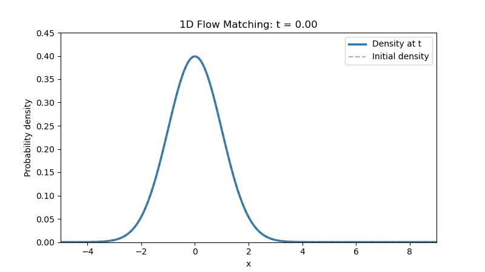

*An intuitive and mathematical introduction with worked examples in one and two dimensions.*

I thought about  writing this post as I am learning/reading about flow matching in order to present it in our reading group (Dr. Sung's reading group). Generative modeling is a fascinating field to me and I am always interested in reading about and interacting with the ideas in the field. What baffles me mostly is the bijection we can establish between the core ideas and some basic concepts we learnt in either high school or during early undergrad days.

This particular post is about flow matching (other group members have already presented on score matching and diffusion models). We start by looking at the conceptual difference between these three generative modeling paradigms.

## 1. Flow matching, score matching, and diffusion models: what is the difference?

Generative modeling begins with a simple question: how can we produce new samples resembling observations from a complicated probability distribution? One approach starts with a simple reference distribution, often a standard Gaussian, and learns a mechanism for transforming its samples into samples from the distribution of interest.

Three closely related ideas are **score matching**, **diffusion models**, and **flow matching**. They are not three mutually exclusive families. Score matching is principally an estimation method; diffusion models specify a stochastic noising process and a generative reverse process; flow matching is a training method for a deterministic velocity field associated with a chosen probability path.

**Score matching.** For a density $p(x)$, the *score* is $s(x)=\nabla_x\log p(x)$. Score matching estimates this vector field without requiring the density's normalizing constant. In modern denoising score matching, a model $s_\theta(x,t)$ is trained to estimate the score of a noise-perturbed distribution $p_t$. The score points in directions of increasing log density; it is not, by itself, the transport velocity of an arbitrary flow.

**Diffusion models.** A typical forward diffusion gradually corrupts data through a stochastic differential equation (SDE)

$$dX_t=f_t(X_t)\,dt+g_t\,dW_t,$$

where $W_t$ is Brownian motion. Generation reverses this process, commonly using a learned time-dependent score. Under suitable regularity assumptions, the same marginal distributions can also be generated by a deterministic *probability-flow ODE*, whose velocity is

$$v_t(x)=f_t(x)-\tfrac12 g_t^2\nabla_x\log p_t(x)$$

when $g_t$ is scalar and depends only on time. Thus, diffusion and deterministic flows can be mathematically connected.

**Flow matching.** Instead of learning a score and converting it into a velocity, flow matching directly trains a vector field $v_\theta(t,x)$ that transports a reference distribution along a prescribed family of intermediate distributions $p_t$. Samples are generated by solving an ODE,

$$\frac{dX_t}{dt}=v_\theta(t,X_t),\qquad X_0\sim p_0.$$

| Aspect | Score matching | Diffusion models | Flow matching |
|---|---|---|---|
| Primary learned object | Score $\nabla\log p_t$ | Usually a score or noise predictor | Velocity $v_t$ |
| Main modeling idea | Estimate density gradients | Reverse a stochastic noising process | Transport mass along a probability path |
| Typical generation | Through a sampler using the learned score | Reverse SDE or probability-flow ODE | Integrate a learned ODE |
| Relationship | Often trains diffusion models | Can admit an equivalent marginal ODE | Can use diffusion-like or other probability paths |

The important distinction is therefore **what we learn and how we use it**, not simply “stochastic versus deterministic.” A diffusion model can be sampled with an ODE, and flow matching can be applied to probability paths also used in diffusion modeling.

## 2. The conceptual and mathematical framework of flow matching

### 2.1 A path of probability distributions

Let $p_0$ be a simple reference distribution and $p_1$ the target data distribution. We seek a family $\{p_t:0\le t\le1\}$ with endpoints $p_0$ and $p_1$.

Imagine a cloud of particles initially distributed according to $p_0$. As time increases, particles move continuously; their collective distribution changes until it matches $p_1$. A time-dependent vector field $v_t:\mathbb R^d\to\mathbb R^d$ determines their motion:

$$\dot X_t=v_t(X_t).$$

For a sufficiently regular velocity field and density, conservation of probability mass is expressed by the **continuity equation**:

$$\boxed{\partial_t p_t(x)+\nabla\cdot\big(p_t(x)v_t(x)\big)=0.}$$

This is the fundamental equation connecting the motion of individual particles to the evolution of their probability density.

### 2.2 Constructing paths from endpoint pairs

Choose a joint distribution (a *coupling*) $\pi(x_0,x_1)$ with marginals $p_0$ and $p_1$. A simple interpolation is

$$X_t=(1-t)X_0+tX_1,\qquad (X_0,X_1)\sim\pi.$$

Differentiating each sampled trajectory yields its conditional target velocity:

$$U_t=X_1-X_0.$$

Many different endpoint pairs can pass through the same intermediate location $x$ at time $t$, potentially with different velocities. Consequently, the population velocity field is the conditional mean

$$\boxed{v^*(t,x)=\mathbb E[X_1-X_0\mid X_t=x].}$$

Under suitable integrability and regularity assumptions, this field satisfies the continuity equation for the interpolated marginal distributions $p_t$. The choice of coupling matters: different couplings can induce different intermediate distributions and different velocities, even when the endpoints agree.

### 2.3 The flow-matching loss

Let $v_\theta(t,x)$ be a neural network with parameters $\theta$. We train it using

$$\boxed{\mathcal L(\theta)=\mathbb E_{t,(X_0,X_1)}\left[\left\|v_\theta(t,(1-t)X_0+tX_1)-(X_1-X_0)\right\|^2\right],}$$

where, for example, $t\sim\operatorname{Uniform}(0,1)$ independently of the endpoint pair. By the $L^2$ projection property of conditional expectation, the optimal predictor is $v^*(t,x)=\mathbb E[U_t\mid X_t=x]$ almost everywhere under the training distribution.

In practical *conditional flow matching*, we sample endpoints and intermediate positions, calculate their target velocities, and optimize this regression objective. We need not explicitly evaluate the intermediate density $p_t$ or its score.

Once trained, generate a new observation by drawing $X_0\sim p_0$ and numerically integrating the learned ODE from $t=0$ to $t=1$.

### 2.4 A subtle point: the coupling is part of the model design

Independent endpoint sampling, $\pi=p_0\otimes p_1$, is simple and widely useful. But it is not the only choice. A carefully selected coupling can make paths straighter and the velocity easier to learn. The worked examples below use an especially transparent *deterministic Gaussian coupling*, which admits closed-form expressions. The same general loss applies, but its optimal velocity differs from the one obtained with independent endpoints.

## 3. Worked example I: transporting a one-dimensional Gaussian

We want to transport

$$X_0\sim\mathcal N(0,1)\quad\longrightarrow\quad X_1\sim\mathcal N(2,4).$$

Let $Z\sim\mathcal N(0,1)$ and choose the coupling $X_0=Z$ and $X_1=2+2Z$. Under linear interpolation,

$$\begin{aligned}X_t&=(1-t)Z+t(2+2Z)\\&=2t+(1+t)Z.\end{aligned}$$

Thus the intermediate marginal is

$$\boxed{p_t=\mathcal N\big(2t,(1+t)^2\big).}$$

At $t=0$ this is $\mathcal N(0,1)$, and at $t=1$ it is $\mathcal N(2,4)$.

Differentiate the sample path:

$$\dot X_t=2+Z.$$

To express the velocity using the current position $x$, note that $Z=(x-2t)/(1+t)$. Hence

$$\boxed{v_t(x)=2+\frac{x-2t}{1+t}=\frac{x+2}{1+t}.}$$

This is the exact velocity field. A flow-matching model trained on pairs $(t,X_t)$ with targets $U_t=2+Z$ has the population objective

$$\mathcal L(\theta)=\mathbb E_{t,Z}\left[\left(v_\theta(t,2t+(1+t)Z)-(2+Z)\right)^2\right].$$

**Verify by solving the ODE.** Starting from $X_0=Z$, solve

$$\dot X_t=\frac{X_t+2}{1+t}.$$

Since $d\log(X_t+2)/dt=1/(1+t)$ wherever the logarithm is defined (or equivalently by a linear-ODE integrating factor), the solution is

$$X_t+2=(X_0+2)(1+t),\qquad X_t=2t+(1+t)X_0.$$

Therefore $X_1=2+2X_0\sim\mathcal N(2,4)$, as required. The same calculation also verifies that the mean increases linearly while the standard deviation grows from 1 to 2.

A useful plot for this example overlays the Gaussian densities at $t=0,0.25,0.5,0.75,1$, and a second plot traces trajectories $x_t=2t+(1+t)z$ for selected initial values $z$.


### Illustration

Consider transporting samples from

$$
X_0 \sim \mathcal N(0,1)
$$

to

$$
X_1 \sim \mathcal N(2,4).
$$

The intermediate probability path is

$$
X_t \sim \mathcal N(2t,(1+t)^2).
$$

The following animation illustrates the evolution
of the probability density as $t$ varies from 0 to 1.



*Figure 1: Evolution of a Gaussian distribution under
the flow matching velocity field.*

```python

import numpy as np
import matplotlib.pyplot as plt
from matplotlib.animation import FuncAnimation, PillowWriter
from scipy.stats import norm

# Reproducibility
rng = np.random.default_rng(42)

# Initial particles
n = 1000
x0 = rng.normal(0, 1, n)

# Time-dependent flow
def flow(x0, t):
    return 2*t + (1+t)*x0

def velocity(x, t):
    return (x + 2)/(1+t)

# Plot setup
fig, ax = plt.subplots(figsize=(8, 4.5))
xgrid = np.linspace(-5, 9, 500)

line, = ax.plot([], [], lw=2.5, label="Density at t")
initial = norm.pdf(xgrid, 0, 1)
ax.plot(xgrid, initial, "--", color="gray",
        alpha=0.6, label="Initial density")

ax.set_xlim(-5, 9)
ax.set_ylim(0, 0.45)
ax.set_xlabel("x")
ax.set_ylabel("Probability density")
ax.legend()

def update(frame):
    t = frame / 100

    mu = 2*t
    sigma = 1+t

    density = norm.pdf(xgrid, mu, sigma)
    line.set_data(xgrid, density)

    ax.set_title(f"1D Flow Matching: t = {t:.2f}")

    return line,

animation = FuncAnimation(
    fig, update, frames=101,
    interval=50, blit=True
)

animation.save(
    "flow_matching_1d.gif",
    writer=PillowWriter(fps=20)
)

plt.show()

```


## 4. Worked example II: transporting a two-dimensional Gaussian

Now let the initial distribution be isotropic,

$$X_0\sim\mathcal N_2\!\left(\begin{bmatrix}0\\0\end{bmatrix},I_2\right),$$

and choose a target with a shifted center and correlated coordinates:

$$X_1\sim\mathcal N_2\!\left(\underbrace{\begin{bmatrix}2\\-1\end{bmatrix}}_{\mu},\underbrace{\begin{bmatrix}4&1\\1&1\end{bmatrix}}_{\Sigma}\right).$$

The covariance matrix is positive definite because its leading principal minors are $4>0$ and $\det(\Sigma)=3>0$.

Take the symmetric positive-definite square root $A=\Sigma^{1/2}$ and let $Z\sim\mathcal N_2(0,I_2)$. Couple the endpoints by

$$X_0=Z,\qquad X_1=\mu+AZ.$$

For this particular matrix,

$$\boxed{A=\frac{1}{\sqrt7}\begin{bmatrix}5&1\\1&2\end{bmatrix},\qquad AA^\top=\Sigma.}$$

Interpolate:

$$X_t=(1-t)Z+t(\mu+AZ)=t\mu+B_tZ,$$

where $B_t=(1-t)I_2+tA$. Because $A$ is positive definite, $B_t$ is invertible for all $t\in[0,1]$. Consequently,

$$\boxed{p_t=\mathcal N_2\big(t\mu,B_tB_t^\top\big).}$$

Differentiating,

$$\dot X_t=\mu+(A-I_2)Z.$$

From $x=t\mu+B_tZ$, recover $Z=B_t^{-1}(x-t\mu)$ and obtain the exact two-dimensional velocity:

$$\boxed{v_t(x)=\mu+(A-I_2)B_t^{-1}(x-t\mu).}$$

This is an affine vector field: its constant component shifts the cloud, while its matrix component stretches and rotates its elliptical contours. At $t=0$ the covariance is $I_2$; at $t=1$ it is $AA^\top=\Sigma$.

The corresponding flow-matching loss is

$$\mathcal L(\theta)=\mathbb E_{t,Z}\left[\left\|v_\theta(t,t\mu+B_tZ)-\big(\mu+(A-I_2)Z\big)\right\|_2^2\right].$$

**Verify the generated distribution.** The solution of the exact ODE with initial value $X_0=Z$ is $X_t=t\mu+B_tZ$, since differentiating it reproduces the velocity above. Therefore at $t=1$,

$$X_1=\mu+AZ\sim\mathcal N_2(\mu,AA^\top)=\mathcal N_2(\mu,\Sigma).$$

For a visualization, plot Gaussian contour ellipses at five times and draw arrows for $v_t(x)$ at a fixed intermediate time. A particle scatter animation shows the initially circular cloud shifting toward $(2,-1)$ and becoming tilted and elongated.

<!-- ## 5. From the toy examples to modern generative modeling

The Gaussian examples have simple exact solutions because we deliberately chose linear transformations. Real data distributions can be multimodal, curved, or concentrated near complicated lower-dimensional structures. In those settings, we generally cannot write down the velocity analytically, and a neural network becomes useful.

Nevertheless, the algorithmic structure remains the same: choose a reference distribution, select a probability path or endpoint coupling, sample training times and locations, regress a vector field onto target velocities, and integrate the learned ODE to generate new observations.

Flow matching does not make the choice of path irrelevant. Different paths can change the complexity of the learned field and the numerical cost of sampling. It is useful to think of flow matching as **learning the dynamics of probability transport**, rather than learning the probability density itself.-->

## Further reading

- Lipman, Y. et al. (2023). *Flow Matching for Generative Modeling*. ICLR. https://arxiv.org/abs/2210.02747
- Song, Y. et al. (2021). *Score-Based Generative Modeling through Stochastic Differential Equations*. ICLR. https://arxiv.org/abs/2011.13456
- Hyvärinen, A. (2005). *Estimation of Non-Normalized Statistical Models by Score Matching*. Journal of Machine Learning Research. https://jmlr.org/papers/v6/hyvarinen05a.html
- Ho, J., Jain, A., and Abbeel, P. (2020). *Denoising Diffusion Probabilistic Models*. NeurIPS. https://arxiv.org/abs/2006.11239
